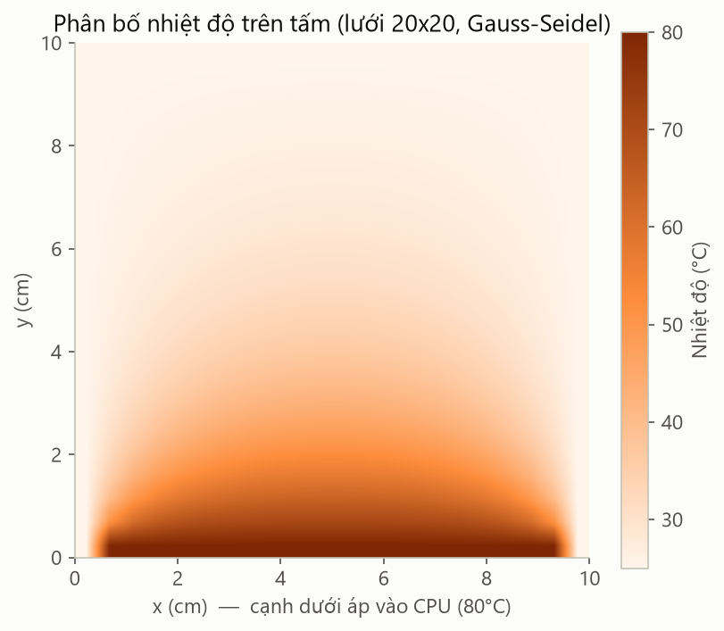
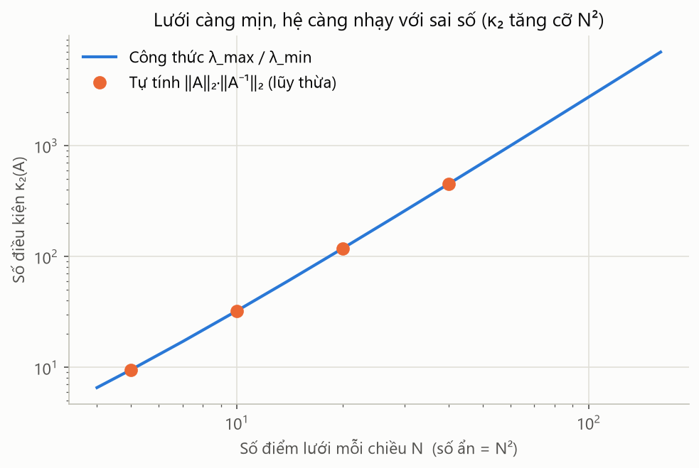
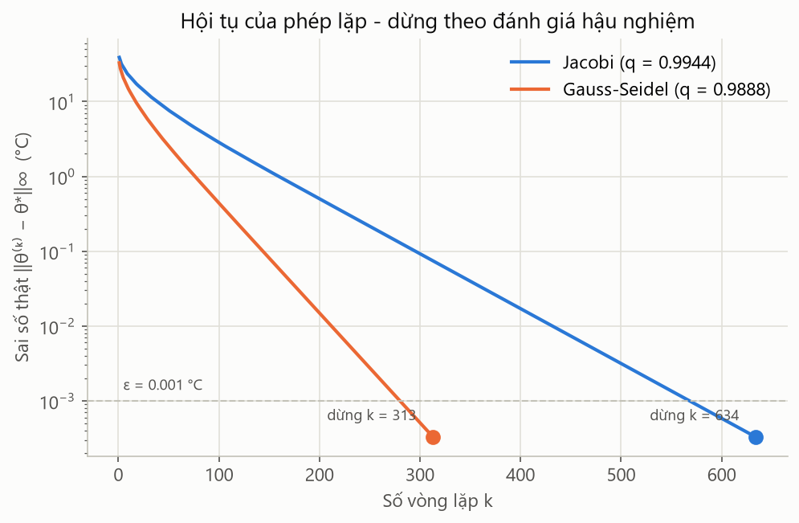
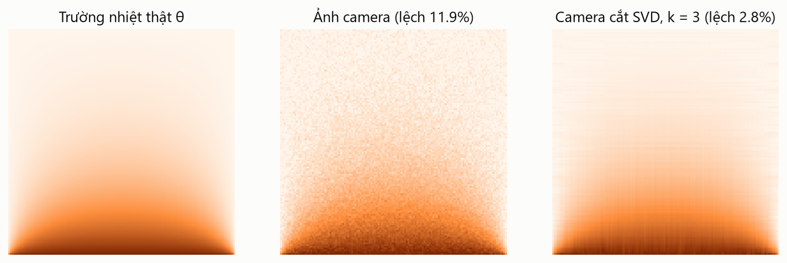

# Giải thích bài toán cho người chưa biết gì

Tài liệu này kể lại bài tập lớn bằng lời thường, không cần biết trước về ma trận hay lập trình. Phần kỹ thuật đầy đủ (công thức, bảng số) nằm trong [README.md](README.md).

---

## 1. Chuyện bắt đầu từ một chiếc máy tính nóng

Bộ vi xử lý (CPU) là "bộ não" của máy tính, và khi làm việc nó nóng lên rất nhanh. Để CPU không bị quá nhiệt, người ta áp lên nó một **tấm kim loại tản nhiệt**: nhiệt từ CPU truyền sang tấm, lan ra khắp tấm, rồi được quạt thổi bay vào không khí.

Trong bài này, tấm tản nhiệt là một miếng nhôm vuông, mỗi cạnh 10 cm, mỏng 1 mm:

- **Cạnh dưới** áp vào CPU nóng **80°C**.
- **Ba cạnh còn lại** gắn vào khung máy, ở nhiệt độ phòng **25°C**.
- **Quạt** thổi lên hai mặt tấm, mang bớt nhiệt đi.

Người thiết kế muốn biết: **mỗi điểm trên tấm nóng bao nhiêu độ?** Biết được điều đó thì mới chọn được tấm đủ lớn, quạt đủ mạnh.

*Kết quả cuối cùng: màu càng đậm càng nóng. Sát CPU (cạnh dưới) khoảng 70°C, lên đến giữa tấm chỉ còn khoảng 31°C.*

---

## 2. Biến tấm kim loại thành một bảng số

Không thể tính nhiệt độ của *vô số* điểm trên tấm, nên ta làm như vẽ trên giấy kẻ ô: **chia tấm thành lưới 20 × 20 điểm**, giống một bàn cờ lớn, tổng cộng 400 điểm.

Vật lý cho ta một quy luật rất dễ hiểu: **nhiệt độ ở một điểm gần bằng trung bình nhiệt độ của 4 điểm hàng xóm** (trên, dưới, trái, phải), chỉ thấp hơn một chút vì quạt thổi mất một phần nhiệt.

Viết quy luật đó cho cả 400 điểm thì được 400 phương trình, mỗi phương trình nối một điểm với hàng xóm của nó. Các hệ số trong 400 phương trình xếp lại thành một **bảng số khổng lồ 400 hàng × 400 cột**, gọi là **ma trận A**. Giải được hệ phương trình là biết nhiệt độ của cả 400 điểm.

> **Ma trận** chỉ đơn giản là một bảng số xếp theo hàng và cột, giống một trang bảng tính Excel.

---

## 3. "Chuẩn của ma trận" là gì?

Với một con số, ta biết ngay nó lớn hay nhỏ. Với một **bảng** 160.000 con số thì sao? Ta cần một cách để gói cả bảng lại thành **một con số duy nhất cho biết bảng đó "mạnh" cỡ nào**. Con số đó gọi là **chuẩn**.

Cách dễ hình dung nhất: coi ma trận như một **cái loa**. Đưa vào một tín hiệu, loa phát ra tín hiệu to hơn hoặc nhỏ hơn. **Chuẩn chính là mức khuếch đại lớn nhất mà cái loa có thể tạo ra.**

Có nhiều cách "đo độ to", nên có nhiều loại chuẩn:

| Chuẩn | Hình dung bằng lời |
|---|---|
| Chuẩn 1 | Cộng độ lớn các số theo từng **cột**, lấy cột "nặng" nhất |
| Chuẩn vô cùng (∞) | Cộng độ lớn các số theo từng **hàng**, lấy hàng "nặng" nhất |
| Chuẩn Frobenius | Coi cả bảng là một danh sách dài, đo "tổng năng lượng" của tất cả các số |
| Chuẩn 2 | Mức **kéo giãn mạnh nhất** mà ma trận tạo ra theo một hướng nào đó |

Bài tập lớn này cho thấy mỗi loại chuẩn giúp trả lời một câu hỏi thực tế khác nhau trong cùng một bài toán tản nhiệt. Có 4 câu hỏi, ứng với 4 bước.

---

## 4. Bước 1 – Đo "độ lớn" của bảng số

Chương trình tự viết các công thức tính 4 loại chuẩn, không dùng hàm có sẵn, rồi kiểm tra bằng hai cách:

- So với hàm có sẵn của thư viện tính toán chuyên nghiệp.
- So với công thức toán viết tay (với bảng số đặc biệt này, người ta tính được đáp án chính xác bằng giấy bút).

Ba cách cho cùng một kết quả đến 6 chữ số thập phân, chứng tỏ code tự viết là đúng. Riêng chuẩn 2 khó tính nhất: máy phải "dò" dần qua 638 lần thử mới ra đáp án (phương pháp này gọi là *phương pháp lũy thừa*).

---

## 5. Bước 2 – Cảm biến đo sai một chút thì kết quả sai bao nhiêu?

Nhiệt độ CPU được đo bằng cảm biến, mà cảm biến nào cũng có sai số; ở đây là **±0.5°C**. Câu hỏi đặt ra: sai số nhỏ ở đầu vào có bị **phóng to** thành sai số lớn ở kết quả không?

Câu trả lời nằm ở một con số gọi là **số điều kiện** (ký hiệu κ, đọc là "kappa"). Nó được tính từ chuẩn và cho biết **bài toán nhạy cảm đến đâu**:

- κ nhỏ (cỡ vài chục, vài trăm): bài toán "điềm tĩnh", sai một chút đầu vào thì kết quả chỉ sai một chút.
- κ khổng lồ (cỡ hàng tỷ): bài toán "dễ hoảng", sai một li đầu vào có thể khiến kết quả đi một dặm.

Tấm tản nhiệt có **κ ≈ 118**, thuộc loại điềm tĩnh. Thực tế, khi cảm biến sai ±0.5°C thì nhiệt độ tính được chỉ lệch nhiều nhất **0.24°C**. Kết quả tin được.

Một phát hiện thú vị: **chia lưới càng mịn thì kết quả càng sát thực tế, nhưng bài toán cũng càng nhạy cảm hơn**. Lưới mịn gấp đôi thì sai số mô hình giảm một nửa, nhưng κ tăng gấp 4. Giống như ống kính zoom: càng phóng to càng thấy rõ chi tiết, nhưng tay càng run thì ảnh càng nhòe.

---

## 6. Bước 3 – Giải bằng cách đoán dần, và khi nào thì dừng?

Giải thẳng 400 phương trình một lúc rất tốn công. Có một cách khéo hơn: **đoán đại một lời giải** (ví dụ cả tấm đều 25°C), rồi **sửa dần từng vòng**, mỗi điểm lại lấy theo trung bình hàng xóm. Sau mỗi vòng, kết quả gần đáp án đúng hơn một chút. Có hai cách sửa: cách Jacobi (sửa cả lượt rồi mới cập nhật) và cách Gauss-Seidel (sửa xong điểm nào dùng ngay điểm đó), trong đó cách thứ hai nhanh gấp đôi.

Câu hỏi khó là: **sửa đến bao giờ thì dừng?**

Cách nghĩ tự nhiên là: *"Khi hai vòng liên tiếp gần như không khác nhau thì dừng."* Nghe hợp lý nhưng **sai**. Hãy tưởng tượng bạn đi bộ về nhà, mỗi bước ngắn hơn bước trước một chút xíu. Bước chân ngắn lại **không có nghĩa là bạn đã tới nhà**, có khi nhà vẫn còn rất xa.

Chuẩn giúp ta biết chính xác "còn xa bao nhiêu". Từ chuẩn của ma trận ta tính được một **hệ số co q**, cho biết mỗi vòng khoảng cách tới đáp án thu nhỏ lại bao nhiêu phần. Ở đây q ≈ 0.994, tức mỗi vòng chỉ tiến được rất ít, nên phải cẩn thận. Có q rồi, ta có công thức ước lượng **khoảng cách thật còn lại** và chỉ dừng khi khoảng cách đó đủ nhỏ.

Kết quả so sánh, với yêu cầu sai số nhỏ hơn 0.001°C:

| Cách dừng | Dừng ở vòng | Sai số thật lúc dừng |
|---|---|---|
| "Hai vòng gần giống nhau thì dừng" | 327 | 0.059°C, **gấp 59 lần yêu cầu** ✘ |
| Dừng theo ước lượng dùng chuẩn | 634 | 0.0003°C, **đạt yêu cầu** ✔ |

---

## 7. Bước 4 – So với ảnh chụp camera nhiệt

Ngoài đời, kỹ sư kiểm tra lại bằng **camera nhiệt**: loại camera chụp ra ảnh mà mỗi điểm ảnh cho biết nhiệt độ. Một bức ảnh 128 × 128 điểm ảnh **chính là một bảng số**, tức lại là một ma trận!

Ảnh camera luôn có **nhiễu**, những hạt lấm tấm giống ảnh chụp thiếu sáng. Hai câu hỏi đặt ra:

**a) Ảnh camera lệch so với thực tế bao nhiêu?** Lấy ảnh camera trừ đi nhiệt độ thật, được một bảng các "chênh lệch", rồi đo độ lớn của bảng đó bằng **chuẩn Frobenius** (tổng năng lượng). Kết quả: ảnh camera lệch khoảng **12%**.

**b) Có làm sạch ảnh được không?** Có một công cụ toán học gọi là **SVD**, hoạt động giống như tách một bức ảnh thành nhiều **lớp xếp chồng**, từ lớp quan trọng nhất (hình dạng chính) đến các lớp vụn vặt (chi tiết li ti và nhiễu). Vì nhiệt độ trên tấm thay đổi rất mượt, gần như toàn bộ thông tin nằm ở vài lớp đầu, còn nhiễu thì rải đều ra mọi lớp.

Chỉ giữ **3 lớp đầu** và bỏ phần còn lại:

- Độ lệch so với thực tế giảm từ **12% xuống còn 2.8%**, tức là ảnh sạch hơn rõ rệt.
- Chỉ cần lưu **4.7% dữ liệu**, nghĩa là file nhẹ hơn khoảng 20 lần.

Giữ thêm lớp không làm ảnh tốt hơn mà ngược lại, vì các lớp sau chủ yếu là nhiễu.

---

## 8. Tóm tắt toàn bộ bằng một bảng

| Câu hỏi đời thường | Công cụ toán học | Câu trả lời |
|---|---|---|
| Bảng số mô tả tấm tản nhiệt "mạnh" cỡ nào? | 4 loại chuẩn | Code tự viết tính đúng cả 4, khớp thư viện và công thức |
| Cảm biến sai 0.5°C thì kết quả có tin được không? | Số điều kiện κ | κ ≈ 118, kết quả chỉ lệch tối đa 0.24°C: tin được |
| Giải bằng cách đoán dần thì khi nào dừng? | Hệ số co q (từ chuẩn vô cùng) | Phải dừng theo ước lượng dùng chuẩn; dừng "theo cảm giác" sai gấp 59 lần |
| Ảnh camera lệch bao nhiêu, làm sạch được không? | Chuẩn Frobenius, chuẩn 2, SVD | Lệch 12%; giữ 3 lớp SVD còn 2.8% và nhẹ hơn 20 lần |

**Thông điệp chính:** chuẩn của ma trận không chỉ là một định nghĩa trong sách. Nó là **thước đo** giúp kỹ sư trả lời những câu hỏi rất thực tế: tính có đúng không, có tin được không, khi nào thì dừng, và mô phỏng khớp với thực tế đến đâu.

---

## 9. Từ điển nhỏ

| Thuật ngữ | Nghĩa đơn giản |
|---|---|
| Ma trận | Bảng số xếp theo hàng và cột |
| Chuẩn | Một con số đo "độ lớn" hay mức khuếch đại tối đa của ma trận |
| Hệ phương trình | Nhiều phương trình phải thỏa mãn cùng lúc; ở đây là 400 phương trình cho 400 điểm |
| Số điều kiện (κ) | Độ "nhạy cảm" của bài toán với sai số đầu vào |
| Phương pháp lặp | Giải bằng cách đoán rồi sửa dần qua nhiều vòng |
| Hệ số co (q) | Mỗi vòng lặp, khoảng cách tới đáp án thu nhỏ lại còn q lần; q càng gần 1 thì càng chậm |
| SVD | Cách tách một ma trận (ví dụ một bức ảnh) thành các lớp từ quan trọng đến vụn vặt |
| Nhiễu | Sai lệch ngẫu nhiên khi đo, như hạt lấm tấm trên ảnh |
