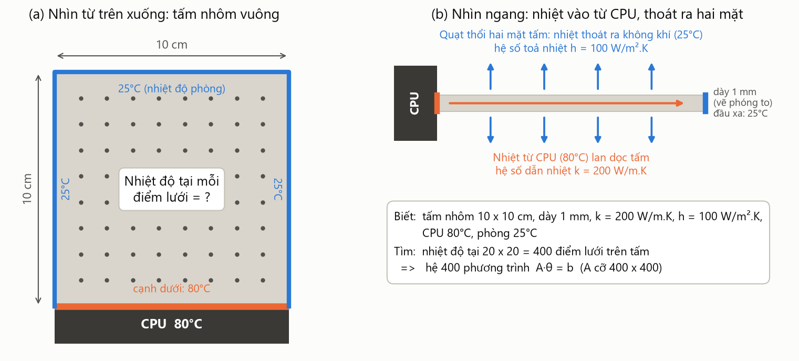

# BTL Đại số tuyến tính – Chuẩn của ma trận
## Bài toán ứng dụng: Phân tích nhiệt độ trên tấm tản nhiệt CPU

Lớp L01 – Nhóm 22 – HK261. Chương trình có cả bản **Python** và **MATLAB**, cho cùng kết quả.

> Chưa quen với ma trận? Đọc [GIAI_THICH.md](GIAI_THICH.md) trước: bài toán được kể lại bằng lời thường, không cần kiến thức nền.

**Bài toán.** Một tấm nhôm vuông 10 × 10 cm, dày 1 mm. Cạnh dưới áp vào CPU nóng 80°C, ba cạnh còn lại gắn vào khung ở nhiệt độ phòng 25°C, hai mặt tấm được quạt thổi để toả nhiệt. Cần biết: nhiệt độ phân bố trên tấm thế nào, kết quả tính có tin được không khi cảm biến đo có sai số, giải hệ phương trình lớn thế nào và khi nào thì dừng, và mô phỏng lệch bao nhiêu so với ảnh chụp của camera nhiệt.

Mỗi câu hỏi được trả lời bằng một chuẩn ma trận, theo đúng dàn ý báo cáo:

| Bước | Câu hỏi | Chuẩn dùng | Mục báo cáo |
|---|---|---|---|
| 1. Lập mô hình | Lập hệ A·θ = b (A cỡ 400 × 400) và tính các chuẩn của A | 1, ∞, F, 2 | 3.3, 4.1 |
| 2. Độ tin cậy | Cảm biến sai ±0.5°C thì nghiệm sai bao nhiêu? Chia lưới mịn hơn thì sao? | Số điều kiện κ₁, κ₂, κ∞ | 3.4, 3.5, 4.2 |
| 3. Giải hệ | Giải bằng Jacobi và Gauss-Seidel, khi nào dừng thì bảo đảm sai số? | ∞ (hệ số co q) | 3.6 |
| 4. So với thực tế | Ảnh camera nhiệt lệch bao nhiêu? Nén và khử nhiễu ảnh bằng SVD | Frobenius, 2 | 4.3 |

---

## Cấu trúc thư mục và cách chạy

Mỗi ngôn ngữ chỉ có **đúng 1 file code**, chạy file đó là ra toàn bộ kết quả:

```
python/phan_tich_tan_nhiet.py    # toàn bộ chương trình Python
python/requirements.txt          # thư viện cần cài: numpy, matplotlib
matlab/phan_tich_tan_nhiet.m     # toàn bộ chương trình MATLAB
ket_qua/                         # hình xuất ra: hinhX_*.png (Python), hinhX_*_matlab.png (MATLAB)
```

Hai file có cùng các phần và cùng tên hàm, nên dễ đối chiếu với nhau:

| Phần | Nội dung | Các hàm |
|---|---|---|
| 1 | Các chuẩn **tự cài đặt** | `chuan_1`, `chuan_vo_cung`, `chuan_frobenius`, `chuan_frobenius_vet`, `chuan_2`, `so_dieu_kien` |
| 2 | Mô hình tấm tản nhiệt | `lap_he`, `tri_rieng_A`, `nghiem_giai_tich`, `ma_tran_lap`, `giai_lap` |
| 3 | Cấu hình đồ thị | màu sắc, thang màu nhiệt, `luu_hinh` |
| 4 | Chương trình chính | nhập thông số (`nhap_thong_so`, `hoi_mot_cau`; MATLAB để ở Phần 5), 4 bước và vẽ 5 hình |

Trong file Python các phần xếp theo thứ tự 1 → 4 từ trên xuống. Trong file MATLAB, phần chạy chính nằm ở đầu file còn các hàm nằm ở cuối, vì MATLAB bắt buộc hàm cục bộ phải đặt sau phần lệnh của script (cần R2016b trở lên).

**Python** (Python 3.9+), chạy từ thư mục gốc repo:

```bash
pip install -r python/requirements.txt
```

```bash
cd python
python phan_tich_tan_nhiet.py
```

**MATLAB** (R2020b trở lên, không cần toolbox): chọn thư mục `matlab` làm Current Folder rồi gõ `phan_tich_tan_nhiet` trong Command Window.

Khi chạy, chương trình cho chọn một trong 3 cách nhập thông số:

1. **Mặc định** (bấm Enter): nhôm, quạt thường, CPU 80°C, phòng 25°C, tấm 10 cm dày 1 mm, lưới 20 × 20.
2. **Tình huống mẫu**: máy văn phòng (không quạt), máy chơi game (mặc định), máy trạm (đồng, quạt mạnh).
3. **Từng câu hỏi**: 7 câu về vật liệu (k), làm mát (h), nhiệt độ phòng, nhiệt độ CPU, cạnh tấm (L), độ dày (t) và lưới (N). Mỗi câu chấp nhận nhiều kiểu trả lời:

| Gõ | Ý nghĩa |
|---|---|
| Enter | Giữ giá trị hiện tại |
| `a` / `b` / `c` | Chọn lựa chọn có sẵn |
| Tên lựa chọn (`đồng`, `dong`, `quat manh`) | Như chọn chữ cái, có dấu hay không dấu đều được |
| Con số, có thể kèm đơn vị (`12 cm`, `120mm`, `0,8`, `90 độ`) | Tự nhập giá trị |
| `?` | Giải thích câu hỏi |

Câu trả lời không hiểu được, sai đơn vị, nằm ngoài khoảng hợp lý (ví dụ N ngoài 5–40) hoặc CPU không nóng hơn phòng đều bị báo lỗi và hỏi lại. Trả lời xong, chương trình in bảng tóm tắt và cho sửa lại trước khi tính. Khi không có bàn phím (chạy tự động, `matlab -batch`), chương trình dùng thông số mặc định.

Toàn bộ kết quả dưới đây ứng với thông số mặc định. Lưu ý: k, h, L, t, N làm thay đổi ma trận A, nên chuẩn và κ thay đổi; còn T_CPU và T_phòng chỉ đổi vế phải b, nên κ giữ nguyên.

---

## Mô hình toán học



*Hình 0 (`hinh0_de_bai.png`, bản MATLAB `hinh0_de_bai_matlab.png`): sơ đồ đề bài. Hình vẽ lại theo thông số người dùng nhập.*

Gọi θ = T − T_phòng là độ tăng nhiệt so với nhiệt độ phòng. Cân bằng nhiệt trên tấm mỏng cho phương trình

  ∂²θ/∂x² + ∂²θ/∂y² − m²θ = 0,  với m² = 2h/(k·t) = 1000 m⁻²

(h = 100 W/m²K: hệ số toả nhiệt khi có quạt; k = 200 W/mK: hệ số dẫn nhiệt của nhôm; t = 1 mm: độ dày tấm).

Chia tấm thành lưới 20 × 20 điểm bên trong, bước dx = L/21. Dùng sai phân 5 điểm, tại mỗi điểm ta có

  (4 + c)·θᵢⱼ − θᵢ₋₁,ⱼ − θᵢ₊₁,ⱼ − θᵢ,ⱼ₋₁ − θᵢ,ⱼ₊₁ = 0,  c = m²·dx² = 0.02268

Ghép 400 phương trình lại thành hệ **A·θ = b**, với A = kron(I, K) + kron(K, I) + c·I và K = tridiag(−1, 2, −1). Bài toán còn có **nghiệm chính xác dạng chuỗi Fourier**; chương trình dùng nghiệm này để kiểm tra sai số của mô hình và làm "trường nhiệt thật" cho camera.

---

## Bước 1 – Lập mô hình và tính chuẩn (mục 3.3, 4.1)

Trước tiên chương trình chạy thư viện tự cài đặt trên các ví dụ trong phần lý thuyết, và ra đúng kết quả: chuẩn 1 = 13, chuẩn ∞ = 12, chuẩn 2 = 7 và 3.702. Sau đó tính các chuẩn của ma trận A cỡ 400 × 400 và đối chiếu với **công thức giải tích**:

| Chuẩn | Tự cài đặt | NumPy / `norm` | Công thức |
|---|---|---|---|
| ‖A‖₁ | 8.022676 | 8.022676 | 8 + c |
| ‖A‖∞ | 8.022676 | 8.022676 | 8 + c |
| ‖A‖_F | 89.402282 | 89.402282 | √(N²(4+c)² + 4N(N−1)) |
| ‖A‖₂ (phương pháp lũy thừa, 638 vòng) | 7.977999 | 7.977999 | λ_max = c + 8sin²(Nπ/(2(N+1))) |

Kết quả cũng kiểm chứng các bất đẳng thức ‖A‖₂ ≤ ‖A‖_F ≤ √r·‖A‖₂ và ‖A‖₂ ≤ √(‖A‖₁·‖A‖∞).

> Ghi chú cài đặt: phương pháp lũy thừa phải bắt đầu từ một véc-tơ ngẫu nhiên. Với ma trận lưới đối xứng như A, véc-tơ (1, …, 1) vuông góc với véc-tơ riêng ứng với λ_max (khi N chẵn), nên sẽ cho kết quả sai.

---

## Bước 2 – Sai số cảm biến và độ ổn định (mục 3.4, 3.5, 4.2)

**a) Số điều kiện:** κ₁ = κ∞ = 165.18, κ₂ = λ_max/λ_min = 118.45. Theo quy tắc kinh nghiệm, giải hệ chỉ mất khoảng 2 chữ số chính xác, nên hệ **ổn định**.

**b) Sai số cảm biến:** mỗi điểm đo dọc cạnh CPU sai ngẫu nhiên tới ±0.5°C. Sai số tương đối của nghiệm luôn nằm giữa hai cận lý thuyết

  (1/κ)·‖δb‖/‖b‖ ≤ ‖δθ‖/‖θ‖ ≤ κ·‖δb‖/‖b‖

và điều này đúng với cả chuẩn 1, 2 và ∞. Tính theo °C, sai số lớn nhất thực tế là **0.24°C**, nhỏ hơn cận ‖A⁻¹‖∞·‖δb‖∞ = 9.6°C. Cận này đúng nhưng khá bi quan, vì nó tính cho trường hợp xấu nhất. Khi chọn b theo véc-tơ kỳ dị u₁ và nhiễu theo uₙ, hệ số khuếch đại sai số **đúng bằng κ₂ = 118.45**, nghĩa là cận trên đạt được, không thể làm chặt hơn.

**c) Đánh đổi khi chia lưới mịn hơn:**

| N | Số ẩn | κ₂ (tự tính) | κ₂ (công thức) | q Jacobi | Sai số mô hình |
|---|---|---|---|---|---|
| 5 | 25 | 9.51 | 9.51 | 0.93506 | 1.52% |
| 10 | 100 | 32.37 | 32.37 | 0.97976 | 0.71% |
| 20 | 400 | 118.45 | 118.45 | 0.99436 | 0.35% |
| 40 | 1600 | 452.02 | 452.02 | 0.99851 | 0.17% |

Lưới mịn gấp đôi thì sai số mô hình giảm một nửa, nhưng κ₂ tăng khoảng 4 lần (tăng cỡ N²) và q càng sát 1, nên phép lặp càng chậm. Đây là đánh đổi có thật trong tính toán kỹ thuật. Để so sánh: ma trận Hilbert chỉ 10 × 10 đã có κ₂ = 1.6·10¹³, còn hệ tấm tản nhiệt dù có 400 ẩn vẫn ổn định hơn rất nhiều. Hình: `ket_qua/hinh2_so_dieu_kien.png`.

---

## Bước 3 – Giải lặp và thuật toán dừng (mục 3.6)

Đưa hệ về dạng lặp x⁽ᵏ⁾ = B·x⁽ᵏ⁻¹⁾ + g. Vì A trội đường chéo chặt nên **q = ‖B‖∞ < 1**, phương pháp lặp hội tụ, và ta có hai đánh giá:

- Tiên nghiệm: ‖x⁽ᵏ⁾ − x*‖ ≤ qᵏ/(1−q)·‖x⁽¹⁾ − x⁽⁰⁾‖, cho biết trước cần bao nhiêu vòng.
- Hậu nghiệm: ‖x⁽ᵏ⁾ − x*‖ ≤ q/(1−q)·‖x⁽ᵏ⁾ − x⁽ᵏ⁻¹⁾‖, dùng làm **điều kiện dừng**: dừng khi vế phải ≤ ε.

Kết quả với ε = 10⁻³ °C:

| | Jacobi | Gauss-Seidel |
|---|---|---|
| Hệ số co q | 0.99436 (q/(1−q) = 176) | 0.98879 (q/(1−q) = 88) |
| Ước lượng tiên nghiệm | ≥ 2601 vòng | ≥ 1269 vòng |
| Dừng theo hậu nghiệm | **634 vòng**, sai số thật 3.3·10⁻⁴ ✔ | **313 vòng**, sai số thật 3.3·10⁻⁴ ✔ |
| Dừng "ngây thơ" khi ‖x⁽ᵏ⁾ − x⁽ᵏ⁻¹⁾‖ ≤ ε | 327 vòng, sai số thật **0.059°C = 59ε** ✘ | 181 vòng, sai số thật **0.028°C = 28ε** ✘ |

Đây là điểm nên nhấn mạnh trong báo cáo. Khi q gần 1, hai lần lặp liên tiếp rất gần nhau nhưng nghiệm vẫn còn cách nghiệm đúng khá xa. Chỉ có đánh giá dựa trên chuẩn của B mới bảo đảm được sai số. Kết quả: nhiệt độ cao nhất trong tấm là 71.4°C (sát CPU), tại tâm tấm là 31.6°C. Hình: `ket_qua/hinh1_ban_do_nhiet.png`, `ket_qua/hinh3_hoi_tu.png`.

---

## Bước 4 – So sánh với ảnh camera nhiệt (mục 4.3)

Ảnh camera nhiệt 128 × 128 điểm ảnh chính là một **ma trận** C, mỗi phần tử là độ tăng nhiệt tại một điểm. Do không có camera thật, chương trình tạo ảnh từ nghiệm chính xác cộng thêm nhiễu đo 2°C. Độ lệch giữa hai ảnh đo bằng chuẩn Frobenius: ‖C − θ‖_F/‖θ‖_F = **11.85%**.

Phân tích SVD C = Σσᵢuᵢvᵢᵀ và giữ k thành phần đầu, được Cₖ. Theo định lý Eckart–Young: ‖C − Cₖ‖_F = √(σ²ₖ₊₁ + …) và ‖C − Cₖ‖₂ = σₖ₊₁. Cột tính trực tiếp và cột tính theo công thức trùng nhau hoàn toàn.

| k | ‖C−Cₖ‖_F | √Σσ² | ‖C−Cₖ‖₂ = σₖ₊₁ | Lệch so với ảnh camera | Lệch so với trường thật | Dung lượng |
|---|---|---|---|---|---|---|
| 1 | 352.19 | 352.19 | 237.97 | 16.15% | 11.33% | 1.6% |
| 2 | 259.64 | 259.64 | 64.81 | 11.90% | 3.44% | 3.1% |
| **3** | 251.42 | 251.42 | 44.16 | 11.53% | **2.77%** | **4.7%** |
| 10 | 226.13 | 226.13 | 38.91 | 10.37% | 5.72% | 15.7% |
| 50 | 113.97 | 113.97 | 22.71 | 5.23% | 10.63% | 78.4% |

Chỉ cần giữ **k = 3** thành phần là độ lệch so với trường thật giảm từ 11.85% xuống **2.77%**, trong khi chỉ phải lưu 4.7% dữ liệu. Lý do là trường nhiệt rất trơn nên có hạng thấp, còn nhiễu trải đều trên mọi thành phần nên bị cắt đi. Nếu giữ nhiều thành phần hơn thì ảnh lại "học" cả nhiễu, nên càng lệch xa trường thật. Hình: `ket_qua/hinh4_anh_camera.png`, `ket_qua/hinh5_do_lech_svd.png`.

---

## Ghi chú

- Các chuẩn đều được **tự cài đặt theo công thức lý thuyết**, rồi đối chiếu với thư viện (NumPy, `norm` của MATLAB) và với công thức giải tích.
- Python và MATLAB dùng chung thuật toán và dữ liệu nên các số ở bước 1, 2a, 2c, 3 trùng nhau. Nhiễu ở bước 2b và 4 dùng bộ sinh số ngẫu nhiên khác nhau, nên các con số đó lệch nhau chút ít giữa hai ngôn ngữ, nhưng kết luận không đổi.
- Thông số vật lý (kích thước, vật liệu, quạt) là giả định hợp lý để minh hoạ, có thể đổi ở biến `THONG_SO` (Python) hoặc hàm `thong_so` (MATLAB), cả hai nằm ở Phần 2 của file code.
- Phiên bản trước gồm 5 bài toán riêng lẻ (có ví dụ chuỗi Markov và nén ảnh thường) vẫn còn trong commit `ff41067`.
